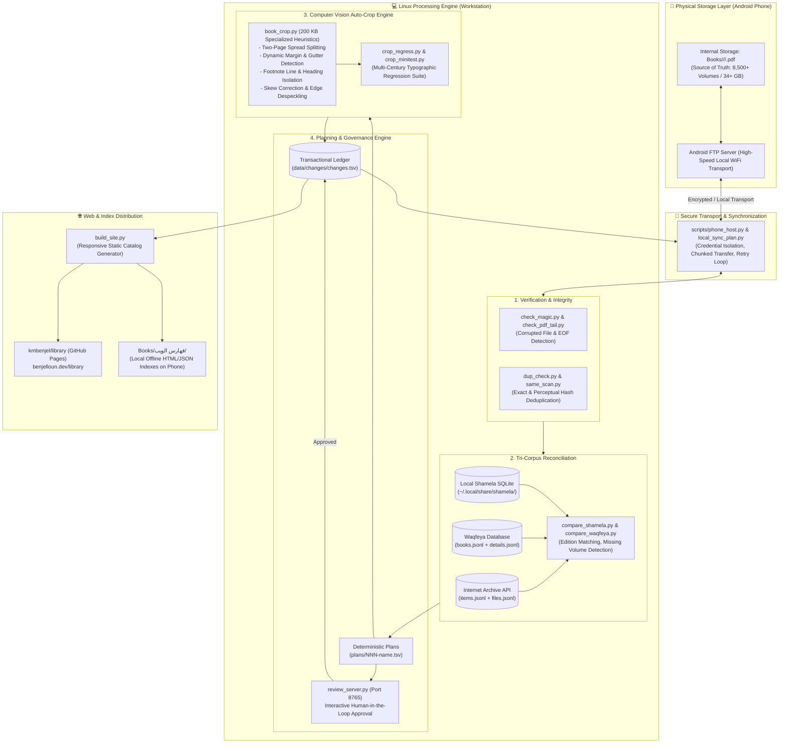
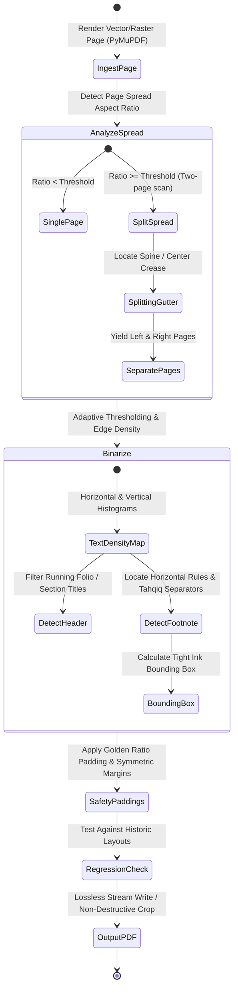
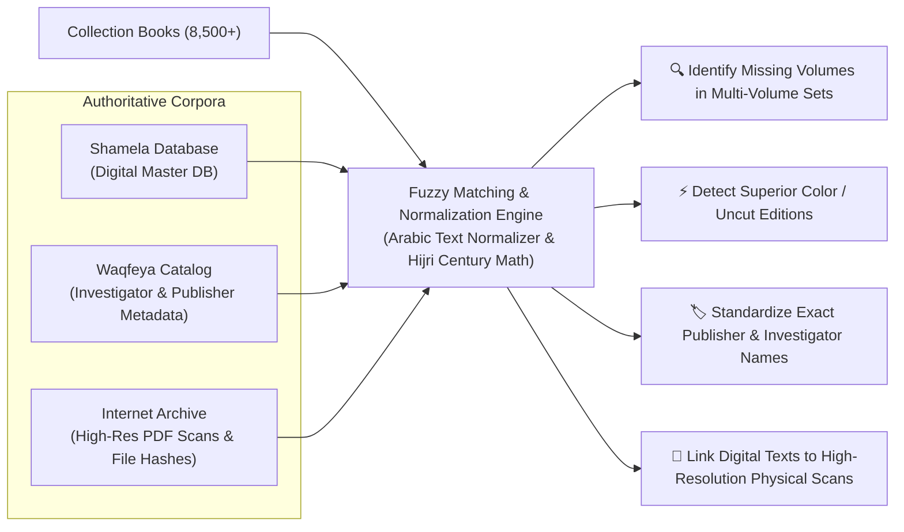

# Phone Library

<div align="center">

**Large-Scale Autonomous Digital Library & Computer-Vision Document Processing Pipeline**

[](https://python.org)
[](https://pymupdf.readthedocs.io/)
[](https://benjelloun.dev/library)
[](https://benjelloun.dev/library)
[](https://benjelloun.dev/library)

[**🌐 Live Catalog & Web Index (benjelloun.dev/library)**](https://benjelloun.dev/library)

</div>

---

## 📌 Executive Summary

**Phone Library** is a production-grade autonomous curation and document-processing pipeline designed to manage, verify, normalize, and optimize a massive collection of classical Arabic and Islamic heritage PDF volumes (**8,500+ books, 34+ GB**).

The system solves a unique hardware-architecture challenge: **the primary digital collection lives on an Android smartphone's internal storage**, while all compute-heavy computer vision, OCR analysis, deduplication, catalog cross-referencing, and web indexing run autonomously on a **Linux workstation** communicating with the device over high-speed local FTP.

Every file alteration, rename, crop, or edition upgrade is strictly governed by deterministic batch plans (`plans/NNN-*.tsv`), audited in an append-only transactional log (`data/changes/changes.tsv`), and verified through automated regression suites and browser-based human-in-the-loop review interfaces.

---

## 🏗️ System Architecture & Data Flow



---

## 🔬 Computer Vision Auto-Crop Pipeline (`book_crop.py`)

Classical Arabic typography presents severe challenges for generic document croppers: varying margins across centuries, non-standard commentary and footnote dividers, dual-column glosses, and irregular scanning gutters.

`scripts/book_crop.py` implements a bespoke multi-stage computer vision algorithm:



### Key CV Capabilities:
1. **Spread Splitting**: Automatically differentiates between single-page scans and open book two-page spreads, isolating the physical gutter without truncating inward margins.
2. **Footnote & Separator Boundary Detection**: Preserves microscopic diacritics and tiny editorial footnote markers often discarded by conventional white-space trimmers.
3. **Typography-Aware Regression Matrix**: Tested against historical editions ranging from Bulaq (19th c.), Matba'at al-Sa'ada, Dar al-Kutub al-Ilmiyya, Dar al-Ma'arif, to modern academic editions.

---

## 📊 Tri-Corpus Reconciliation Engine

The pipeline guarantees that the collection contains the most complete, verified, and highest-fidelity scan of any book:



---

## 🛡️ Engineering Safeguards & Resource Governance

- **Systemd Resource Governors**: Compute-heavy jobs run under dedicated user units with explicit memory boundaries (`MemoryMax=2.5G`), ensuring background cropping never locks or starves workstation development.
- **Append-Only Transactional Ledger**: Every move, rename, join, or crop records `timestamp`, `action`, `source_path`, `dest_path`, `reason`, and `plan_id` in `data/changes/changes.tsv`.
- **Zero Credential Exposure**: FTP credentials and authentication tokens reside exclusively in local runtime environments outside Git tracking.
- **Human-in-the-Loop Web Gate**: High-impact plan batches generate HTML review pages (`scripts/review_server.py`) with side-by-side thumbnail comparisons before commits are executed.

---

## 📂 Repository Layout

```
phone-library/
├── scripts/
│   ├── book_crop.py         # 200 KB Computer vision cropping engine
│   ├── crop_regress.py      # Automated visual regression test runner
│   ├── compare_shamela.py   # Local Shamela SQLite database cross-referencer
│   ├── compare_waqfeya.py   # Waqfeya metadata & volume completeness checker
│   ├── build_catalog.py     # Unified library catalog compiler
│   ├── build_site.py        # Static responsive web reader and search generator
│   ├── review_server.py     # Local HTTP review server (port 8765)
│   ├── phone_host.py        # Android FTP connectivity and transport socket
│   └── publish_web.sh       # Auto-deployment script for GitHub Pages
├── data/
│   ├── changes/changes.tsv  # Append-only transactional ledger of all actions
│   ├── shamela/             # Shamela master database exports
│   ├── waqfeya/             # Waqfeya JSONL catalogs and volume details
│   └── catalog.json         # Complete compiled library index
├── plans/                   # Historical TSV execution plans (370+ batches)
├── AGENTS.md                # Autonomous AI agent guidelines & domain rules
├── HANDOFF.md               # Continuous state handoff across multi-model sessions
└── README.md                # This documentation
```

---

## 📸 Intelligent Cropping, Web Index & Mobile Reader Showcase

> [!NOTE]
> Below are placeholder slots for visual captures, side-by-side computer-vision crop comparisons, and the live catalog web reader.

<div align="center">

| 📖 Before & After CV Cropping | 🌐 Live Web & Mobile Catalog |
|:---:|:---:|
|  <br> *Intelligent margin trimming & footnote boundary preservation* |  <br> *Fast search, instant filters, and cross-category navigation* |

</div>

<br>

<div align="center">

| 🔍 Interactive Review Interface (Port 8765) | 📱 Android Phone Internal Storage Integration |
|:---:|:---:|
|  <br> *Visual side-by-side approval dashboard before atomic moves* |  <br> *34+ GB organized directly on mobile storage over FTP* |

</div>

---

## 📄 License

Engineered with precision by [Khalid Benjelloun](https://benjelloun.dev). Web index accessible at [benjelloun.dev/library](https://benjelloun.dev/library).
