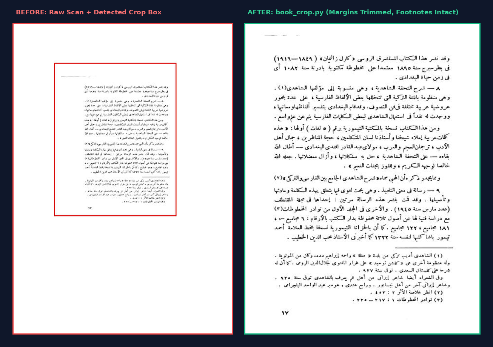
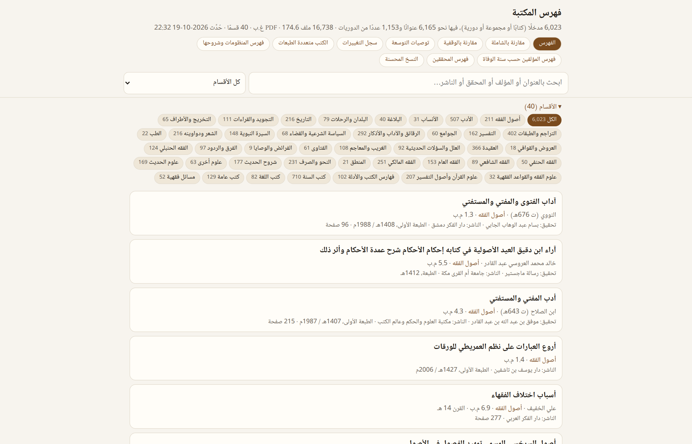
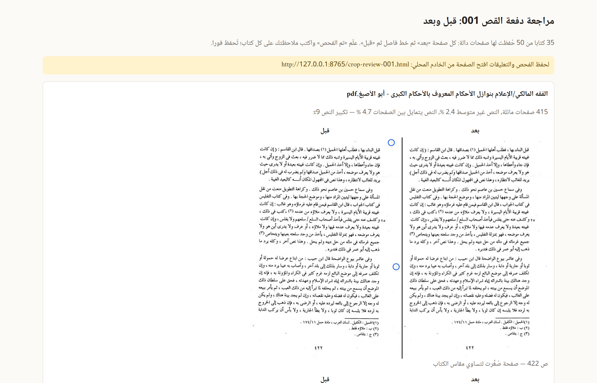
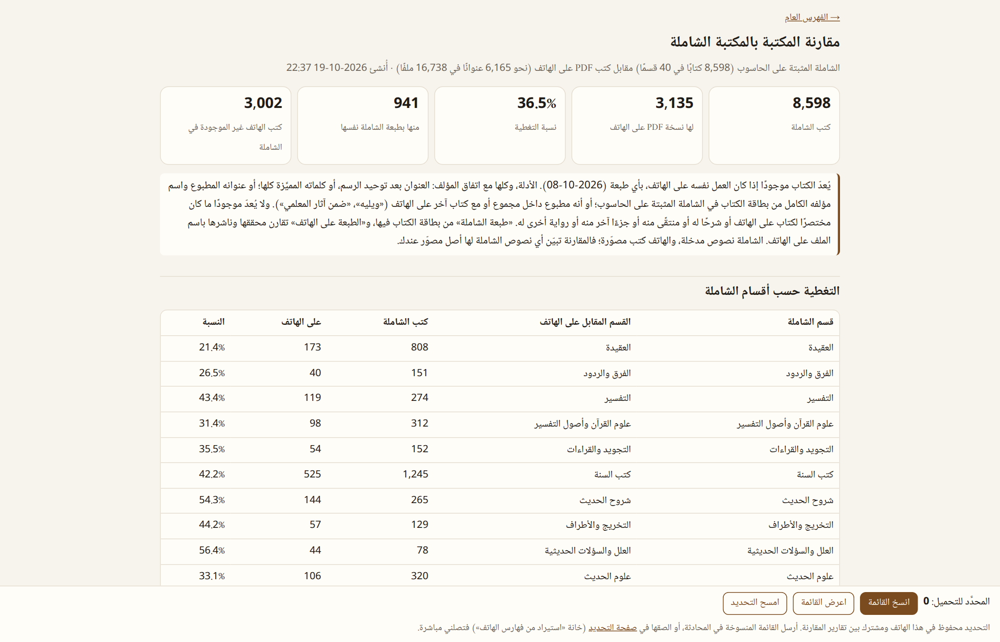

<div align="center">

# A Library in a Pocket · خِزانةٌ في الجيب


**16,757 Arabic heritage PDFs (175 GB) on one Android phone — named, ordered in forty sections, and searchable.**
<!-- TAGLINE-PENDING: the owner is choosing a new tagline; the former one was "Every book under its right name". -->

532 reversible plans · 97,925 logged changes · 474,268 scanned pages set straight by computer vision

[**Open the index → benjelloun.dev/library**](https://benjelloun.dev/library)

[](https://github.com/kmbenjel/phone-library/actions/workflows/ci.yml)

</div>

---

## What this is

A phone holding thousands of unordered PDFs — names like `03_44057.pdf` or `01 - الحيوان_alt.pdf` — became a catalogued library of classical Arabic books: 16,757 files in the forty sections of al-Maktaba al-Shamela, each named on one rule — *title · author · editor · publisher · city* — from the evidence of its own title page.

The books live on the phone. This repository holds the means: the written rules the AI agents work under (`AGENTS.md` and `docs/agents/`) and the 151 small tools in `scripts/` that inventory the phone, apply plans, prove duplicates, compose names, crop pages and build the public index.

The method, in one sentence: **rules before code, a plan for every change, evidence for every name, and a human with the last word.**

## The numbers

| | The first night | Today |
|---|---|---|
| PDF files | 9,469 | **16,757** |
| Size | 99.3 GB | **175 GB** |
| Sections | 29 folders, no system | **40** (the Shamela classification) |
| Books in the catalogue | 2,754 book folders | **6,016** books · 6,160 titles |

| | |
|---|---|
| Logged changes | 97,925 ledger lines: moves and renames, additions, proven duplicates removed, crops |
| Plans | 532, each reversible with the same tool that applied it |
| Pages set straight | 474,268 scanned pages, losslessly |
| Human review | 1,109 remarks from the owner on web review pages |
| Indexed | 1,202 editors · 3,817 books by their author's year of death · 53 canonical didactic poems · manuscripts and the libraries that hold them · 422 multi-edition works |

## Four horizons

**IT.** Two AI agents from two companies work under one written file (`AGENTS.md`) and the same rules. Every change is a three-column plan (from, to, why) applied by one tool and undone by the same tool; everything applied lands in an append-only ledger. Duplicates are proven byte for byte before anything is removed. Page cleanup is computer vision that never touches an image: the crop and the rotation are written into the PDF as a frame and a transform, so they can be undone. A regression bench runs on every change to the algorithm; heavy jobs run on 32-core cloud machines while the laptop keeps the phone's link.

**Culture.** The forty Shamela sections as the shelf order; names read from title pages, with the catalogues as references; indexes of editors, of authors by year of death, of didactic poems and their commentaries, of manuscripts and the libraries that hold them, and of works held in several editions.

**Web publishing.** The index is one static page with tabs, rebuilt from the names after every edit and published to GitHub Pages at [benjelloun.dev/library](https://benjelloun.dev/library). No account, no app, readable on the phone that holds the books.

**Contribution.** The holdings are reconciled with al-Maktaba al-Shamela, al-Maktaba al-Waqfeya and the Internet Archive by edition and exact file size. To suggest a name, an edition or a section, open an issue with the book's title page (a photo is enough): a name changes on evidence, and the ledger records why.

## Screenshots

| Before and after a lossless crop | The public index |
|:---:|:---:|
|  <br> *One frame per book, centred on every page; margins and footnotes kept; the images untouched.* |  <br> *The main index: search by title, author, editor or publisher; the forty sections as chips.* |

| The human in the loop | Reconciliation with the sources |
|:---:|:---:|
|  <br> *Before \| after pages with a remark box; one remark ("make the black frame the standard for tilt") became a rule that re-cropped 1,111 books in a day.* |  <br> *8,598 Shamela books reconciled section by section; 2,999 books here that Shamela does not have.* |

## The method in brief

1. **Inventory** the phone as it is; change nothing yet.
2. **Write the rules** (`AGENTS.md`): a name comes from evidence; every change goes in a plan that can be undone; nothing is deleted unless proven identical byte for byte (same size, then 64 KB samples at five points, then a full checksum on the phone).
3. **Plans and a ledger**: a plan file (from · to · why) → `scripts/apply_plan.py` → an append-only change log.
4. **Names by reading**: `<title> - <author> - ت <editor> - <publisher> <city>`, read from the title page and composed by `scripts/name_compose.py`.
5. **Verification**: duplicates proven, editions told apart from re-scans, holdings reconciled with Shamela, Waqfeya and archive.org by edition and exact file size.
6. **Pages**: `scripts/book_crop.py` finds the text frame, levels the tilt, splits spreads — losslessly — and `crop_regress.py` checks every change against editions from Būlāq to today.
7. **Index**: `scripts/refresh.sh` rebuilds the catalogue and the site; `publish_web.sh` publishes it.
8. **Review loop**: the owner reads before/after pages and writes remarks; a remark becomes a rule, and the rule re-runs.

## Repository map

```
AGENTS.md        the rules every agent reads first
docs/agents/     the long form of each rule: naming, deletion, sources, concurrency, scripts
scripts/         151 small tools: apply_plan.py, fetch_queue.py, name_compose.py, dup_check.py, book_crop.py, refresh.sh …
docs/showcase/   screenshots used here
.github/         CI
```

The books, the plans, the change log and the reference catalogues stay in the private working copy; the public index is built from them.

## If this is useful to you — a star helps others find it

A star on GitHub costs nothing and tells people that the rules and tools here are worth a look. If you have never used GitHub:

1. Open [github.com/signup](https://github.com/signup) and create a free account (an e-mail address is enough).
2. Come back to this page: [github.com/kmbenjel/phone-library](https://github.com/kmbenjel/phone-library).
3. Click **☆ Star** at the top right of the page. That is all — nothing is downloaded and nothing is installed.
4. To hear when the indexes grow, click **Watch → Custom → Releases**.

The same rules work for a single shelf — or an entire library. Your own library: what would it look like?

---

<div dir="rtl" align="right">

## بالعربية

**خِزانةٌ في الجيب** — <span dir="ltr">16,757</span> ملف تراث عربي (<span dir="ltr">175 GB</span>) على هاتف واحد، مسمّاة ومرتّبة في أقسام الشاملة الأربعين، ويُبحث فيها.

هاتفٌ فيه آلاف الملفات بلا ترتيب صار مكتبة مفهرسة: اسم كل كتاب على قاعدة واحدة — العنوان، فالمؤلف، فالمحقق، فالناشر والمدينة — ودليله صفحة العنوان. الوسائل: قواعد مكتوبة يعمل تحتها وكلاء ذكاء اصطناعي، وخطة لكل تغيير يُتراجع عنها، وسجلّ لا يُمحى منه شيء، وإثبات التكرار بايتًا بايتًا، ومقابلة بالشاملة والوقفية وأرشيف الإنترنت، ورؤية حاسوبية تقوّم الصفحات وتقصّها بلا فقد على حواسيب سحابية، وصفحة مراجعة يقرّر فيها صاحب المكتبة.

الفهرس: [benjelloun.dev/library](https://benjelloun.dev/library) — بلا حساب ولا تطبيق: المؤلفون بسنة الوفاة، والمحققون، والمنظومات وشروحها، والمخطوطات وخزائنها، والكتب متعددة الطبعات.

القواعد نفسها تصلح لرفّ واحد… أو لخزانة كاملة. مكتبتك أنت… كيف ستبدو؟

</div>

---

## Licence and credits

The code (`scripts/`) is under the MIT License; the documentation (`docs/`, `AGENTS.md`) and the indexes at [benjelloun.dev/library](https://benjelloun.dev/library) are under CC BY 4.0. The books themselves are not in this repository.

Built by [Khalid Benjelloun](https://benjelloun.dev) with two AI agents — Claude (Anthropic) and Antigravity (Google) — working under `AGENTS.md`. The reference catalogues are al-Maktaba al-Shamela, al-Maktaba al-Waqfeya and the Internet Archive: references, never substitutes for the title page. Fonts in the identity: Amiri, IBM Plex Sans Arabic, Kawkab Mono, Readex Pro.
